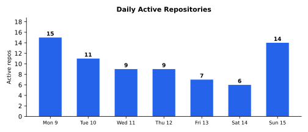

# Weekly Progress Report — 2026-11-09…11-15

## Executive Summary

**Twenty repositories** landed **487 commits** across plugin platforms, fleet tooling, decimal performance, drawing surfaces and commercial products. **[marcelocantos/t3code](https://github.com/marcelocantos/t3code)** gained an external plugin system for sidebar panels, composer buttons and link handling, and **[marcelocantos/bullseye](https://github.com/marcelocantos/bullseye)** became the first daemon-hosted plugin, in three releases. **[canticode/orthograph](https://github.com/canticode/orthograph)** shipped v0.1.0, grew an Android companion, and moved verification fully local. **[marcelocantos/spyder](https://github.com/marcelocantos/spyder)** shipped six releases that give it simulator leases, simulator inventory and pruning, and self-healing iOS automation. **[marcelocantos/go-decimal-proposal](https://github.com/marcelocantos/go-decimal-proposal)** tuned the decimal kernel through a dozen pinned fork revisions and finished its design document. **[marcelocantos/loadmon](https://github.com/marcelocantos/loadmon)** became a load-accounting daemon with per-process ledgers and incidents. **mnemo**, **vellum** and **claudia** shipped eight more releases, and **[marcelocantos/threedee](https://github.com/marcelocantos/threedee)** printed four new parts and gained LAN tools for the Bambu X1 Carbon. Commercial work — **HMS**, **Stock Cars** and **yourworld2** — is stubbed below and told in full in the private companion.

**487 commits** | **+161,389 net lines** | **~104-163 person-days traditional equivalent** | **~23-65x multiplier**

### Major Achievements & Innovations

- **A plugin platform for T3 Code** ([marcelocantos/t3code](https://github.com/marcelocantos/t3code)). External sidebar plugins arrived as a protocol: composer buttons, plugin surfaces, environment panels and a Settings → Plugins page (#2), then plugins that take over the links they claim, with glob patterns that also claim file links (#3, #4). Web and mobile clients ask the owning plugin before following a click, panels size themselves to their reported content height, and plugin builds are signed with a Developer ID and notarised locally. Sidecars are the only plugins T3 starts, and their config is re-read.
- **Bullseye lives inside the thread view** ([marcelocantos/bullseye](https://github.com/marcelocantos/bullseye) v0.59.0–v0.61.0). The daemon advertises one unsuffixed T3 manifest slot under its canonical `github.com/marcelocantos/bullseye` identity and withdraws only its own file (T115). Targets carry an optional calendar due date shown in an environment panel with row actions, hovercards and dialogs (T116). YAML becomes the default startup configuration (T117), the schema records executor and reviewer model preferences (T107), and Homebrew installs retain dependency licences (T118, T119).
- **Orthograph v0.1.0 and an Android pad** ([canticode/orthograph](https://github.com/canticode/orthograph)). The first release shipped with permanent gated pushes. The Android companion pairs with a one-use launch code, keeps camera gestures steady when fingers lift, and shares Undo and Redo. A browser pad host embeds in T3 Code as a web-panel plugin, with a still thumbnail that opens an editor modal. All GitHub Actions were removed and verification runs locally.
- **Spyder owns simulators and heals iOS** ([marcelocantos/spyder](https://github.com/marcelocantos/spyder) v0.105.0–v0.110.0). Spyder alone boots and shuts down iOS simulators through leases (🎯T188), keeps a simulator inventory with provenance and claims, and prunes dry-run-first (🎯T189). Event subscriptions generalise thread notifications (🎯T181, 🎯T183), waiting verbs no longer trip the self-restart (🎯T185), and iOS automation recovers from unmounted developer services (🎯T191).
- **Decimal types that follow the float precedent** ([marcelocantos/go-decimal-proposal](https://github.com/marcelocantos/go-decimal-proposal)). Twelve pin moves tuned the kernel (formatting in place, a 128-bit remainder step, allocation-free powers and logarithms, decimal64 operators measured beside `float64`), with side-by-side benchmarks and linux/amd64 figures from CI. The design document was finished for submission, and the decimal bit functions moved to `math/decimal`.
- **Loadmon accounts for agent load** ([marcelocantos/loadmon](https://github.com/marcelocantos/loadmon)). `loadmon-api` is now the sampling daemon with a per-process ledger, every process is attributed to the workload that drives it, and incidents open and close from rules over workload load before moving to notify mode with caps, acknowledgement and escalation (T2). Per-project behaviour profiles judge heavy runs, and the daemon's own cost was cut and measured under load (T5).
- **Releases elsewhere.** **mnemo** v0.117.0–v0.118.0: a backup destination that does not answer never blocks the daemon, and snapshots stage locally until it returns (T199–T201). **vellum** v0.38.0–v0.40.0: a modal CodeMirror source editor that opens at the page's scroll position and carries the selection. **claudia** v0.86.0–v0.88.0: usage journals that recover from sequence gaps (T1397, T1398).

### Significant Progress

- **Orthograph beyond the iPad.** The browser pad host, per-thread documents, a narrow-screen editor and Luau-defined shared icons landed alongside the release, extending the surface to Android and to T3 Code threads.
- **Mnemo hours.** Attended and agent hours per project are computed from indexed data and exposed as `mnemo_hours` and `mnemo hours` (T202), with the cutoff live check (T201) added to the attestation.

### Tough Challenges Overcome

- **A backup that waits on an absent disk** ([marcelocantos/mnemo](https://github.com/marcelocantos/mnemo), T200, T201). A destination that did not answer could block the daemon. Every backup-dir call is now bounded, snapshots stage locally while `backup.dir` is away, and replication resumes when it returns. The live check kills the daemon with SIGKILL and with a graceful stop mid-replication, and the replica is closed before renaming or deleting it on Windows.
- **Sequence gaps in usage journals** ([marcelocantos/claudia](https://github.com/marcelocantos/claudia), T1398). Seats resumed after compaction with a discontinuous usage sequence. Gap journals are poisoned, the stored sequence identity is preserved, and oracles cover the cursor chain and `createSeatAgent` reload.
- **The cost of watching load** ([marcelocantos/loadmon](https://github.com/marcelocantos/loadmon), T5). The monitor itself was a load source: it walked `~/Library`, spent CPU in FSEvents callbacks and ran `nettop` every tick. Candidates are scanned at most every ten minutes, cheap test first, never shallower than their rule's depth, with registry reads and one `nettop` snapshot per tick.
- **iOS developer services that unmount** ([marcelocantos/spyder](https://github.com/marcelocantos/spyder), 🎯T191). Automation now detects unmounted developer services and remounts them, and starts sooner. A go-ios bump stops `browseApps` spinning on a dead connection.
- **QUIC stream endings** ([marcelocantos/pigeon](https://github.com/marcelocantos/pigeon), 🎯T64, 🎯T67). WebTransport and the C ngtcp2 binding now emit STREAM FIN versus RESET_STREAM correctly, and the paired-session e2e dial is stable under load.

### Contributors

- Marcelo Cantos (AI co-authors — Claude, Grok, Cursor, Codex — on trailers throughout).

---

## Plugins & Drawing Surfaces

### [marcelocantos/t3code](https://github.com/marcelocantos/t3code) — External Plugins (8 commits)

- **Plugin protocol**: sidebar plugins and daemon-hosted Bullseye panels (#1); composer buttons, plugin surfaces, environment panels and Settings → Plugins (#2).
- **Link handling**: plugins claim links they own (#3), with glob patterns that also claim file links (#4); plain clicks on the web client and taps on mobile ask the plugin first, and patterns can hand clicks to a plugin.
- **Panels and builds**: sidebar web panels fit their reported content height, hover cards dismiss after leaving panel and card, and plugin builds sign with a Developer ID and notarise locally.
- **Tests**: about 87 new test declarations, including a detail view on the panel root.

### [canticode/orthograph](https://github.com/canticode/orthograph) — v0.1.0 and Android (28 commits, v0.1.0)

- **Release path**: permanent gated pushes, checksums that verify beside downloaded archives, binary media requested only for private release assets, a publish into an empty Homebrew tap, and the owner oracle kept local. GitHub Actions were removed so that all verification runs locally.
- **Android companion**: one-use launch-code pairing, display-speed camera gestures that stay steady when fingers lift, compact layouts, and shared Undo and Redo for paired pads; successful Undo and Redo stay silent.
- **T3 Code integration**: a browser pad host embedded as a web-panel plugin, one document per T3 thread, a still thumbnail that opens an editor modal with Submit, a composer entry on the canvas panel, and an editor that maximises on constrained screens.
- **Shared definitions**: icons and colour selection are defined once in Luau; object selection stays in Select mode, and every iPad uses the public service.

### [marcelocantos/bullseye](https://github.com/marcelocantos/bullseye) — T3 Panels (14 commits, v0.59.0–v0.61.0)

- **Plugin discovery**: an opt-in `/plugins/t3` sidebar endpoint (T114), a canonical identity and a single manifest slot (T115).
- **Due dates and models**: calendar due dates on targets (T116) and executor and reviewer model preferences (T107).
- **Configuration and packaging**: YAML default startup (T117), complete help and bundled licence notices (T118), licences retained in Homebrew installs (T119). About 66 new tests.

---

## Agent & Fleet Infrastructure

### [marcelocantos/spyder](https://github.com/marcelocantos/spyder) — Simulators and Notifications (20 commits, v0.105.0–v0.110.0)

- **Leases and inventory**: simulator leases (🎯T188), inventory with provenance, claims and a dry-run-first prune (🎯T189); Android virtual device leases were filed as 🎯T190.
- **Notifications**: T3 Code threads are notified when requested devices connect (🎯T181) and generalised into event subscriptions (🎯T183).
- **Reliability**: waiting verbs no longer trip the self-restart and keep exit evidence (🎯T185); iOS automation self-heals (🎯T191); agent verbs reject a device name that matches nothing. Bulk-data following (🎯T192) was set aside by the owner. About 47 new tests.

### [marcelocantos/loadmon](https://github.com/marcelocantos/loadmon) — Load Accounting (54 commits)

- **Design to daemon**: a load-accounting design folded through two executor reviews became `loadmon-api`, a sampling daemon with a per-process ledger; the menu-bar app is now a client and the legacy store is deleted.
- **Incidents**: rules over workload load open and close incidents in observe mode (T2.1–T2.4), and messages go out in notify mode with caps, acknowledgement and escalation; Sentinel's disk alerts rest on loadmon's API (T7) and only incidents are published.
- **Spyder inventory**: loadmon matches spyder's live inventory (T3.1), follows its REST answer in MCP content shape, and counts space projects keep outside their trees (T3).
- **Overview and cost**: one overview carries the census, hosts, location ids and last changes; the daemon's and app's own cost was cut and measured (T5), and `nettop`'s cost with the popover open is tracked (T6). About 142 new tests.

### [marcelocantos/mnemo](https://github.com/marcelocantos/mnemo) — Backup Resilience (14 commits, v0.117.0–v0.118.0)

- **Backup health**: `backup.recent` judges `last_daily_success` and counts any-tag success (T199), and `backup.dir` is honoured on every backup path.
- **Absent destinations**: bounded calls, local staging and deferred replication (T200, T201), with the cutoff live check in the attestation.
- **Hours**: attended and agent hours per project from indexed data (T202); v0.118.0 is Developer ID signed. About 52 new tests.

### [marcelocantos/claudia](https://github.com/marcelocantos/claudia) — Usage Journals (13 commits, v0.86.0–v0.88.0)

- **Usage**: Cursor broker plan fetch goes through the managed store, encrypted IDE fallback tokens are rejected (T1397), and gap journals recover with their sequence identity intact (T1398).
- **Shutdown**: the OMP seat joins `auth_retry` and the pump safely before teardown (T169).

### [marcelocantos/vellum](https://github.com/marcelocantos/vellum) — Source Editor (15 commits, v0.38.0–v0.40.0)

- **Editor**: a modal CodeMirror source editor opens at the page's scroll position and closes back, carries the page selection, and shows it on the cursor's line.
- **Viewer**: icon buttons for edit, copy and reveal, and a PDF button replaces the download menu.
- **Releases**: table headings stay visible while scrolling (v0.38.0), installed pandoc reference decks replace a bundled one (v0.39.0), and PDF fit checks are portable across extractors.

---

## Libraries, Hardware & Documents

### [marcelocantos/go-decimal-proposal](https://github.com/marcelocantos/go-decimal-proposal) — Kernel Performance (23 commits)

- **Fork pins**: twelve pin moves (#23–#35) tracked a fork whose kernel gained four-digit formatting, a 128-bit remainder step, sign functions, in-place long-coefficient formatting, stored bits and codecs, and allocation-free powers and logarithms in `math/decimal`.
- **Measurement**: a side-by-side decimal128 benchmark harness with operands drawn without a pattern, application benchmarks with the built-in type, money rows, and linux/amd64 figures from CI.
- **Submission**: the performance write-up, a finished design document, and the decimal bits functions moved to `math/decimal`.

### [marcelocantos/threedee](https://github.com/marcelocantos/threedee) — Prints and Printer Tools (5 commits)

- **Parts**: a 3×3 picture-cube puzzle tray (v5), an open-lattice SSD stand (v2.2), an upright stand for a stick-blender motor body, and stress-relief slots with a diamond lattice on the scale cradle (v8).
- **Tools**: local LAN tools for the Bambu X1 Carbon.

### [squz/ge](https://github.com/squz/ge) — Engine Fixes (7 commits)

- **Platforms**: the Android Vulkan surface is rebuilt when the app returns from the background, and iOS tilt and accelerometer data are framed by UIKit's interface orientation rather than SDL's.
- **Behaviour**: drag timing follows simulation time under pause and step, a stationary globe hold no longer releases the pre-hold flick, and one FreeType face is kept per thread per font. The memory-footprint sample gate now fires, and the process physical footprint is published for spyder.

### Smaller landings

**[marcelocantos/pigeon](https://github.com/marcelocantos/pigeon)** (2): QUIC stream-ending and e2e dial fixes (above). **[marcelocantos/gadgets](https://github.com/marcelocantos/gadgets)** (2): `sshbox` commands and device policy moved into `x`, and a single compressed filesystem OS is required. **[marcelocantos/gouml](https://github.com/marcelocantos/gouml)** (3): epoch-millisecond dates, antialiasing enum constants and inner-superclass instance copying. **[marcelocantos/skills](https://github.com/marcelocantos/skills)**, **[progress-reports](https://github.com/marcelocantos/progress-reports)** and **[progress-reports-private](https://github.com/marcelocantos/progress-reports-private)** (1 each): the skills sync and the weekly report series.

---

## Commercial

**[Health-Management-Systems/hms](https://github.com/Health-Management-Systems/hms)** — 11 commits, +34,593/−3,464 after the `hms2/tools` evidence and generated-file excludes. **[minicadesmobile/stock-car-racing](https://github.com/minicadesmobile/stock-car-racing)** — 48 commits. **[squz/yourworld2](https://github.com/squz/yourworld2)** — 217 commits. Full narrative: [private week 2026-11-15](https://github.com/marcelocantos/progress-reports-private/blob/master/reports/weekly-report-2026-11-15.md).

---

## In-Flight / Work-in-Progress (unmerged — not counted in shipped totals)

- **The Go decimal fork** ([golang/go](https://github.com/golang/go)): 244 commits on branches. **[marcelocantos/go-decimal-proposal](https://github.com/marcelocantos/go-decimal-proposal)**: 59. **[marcelocantos/t3code](https://github.com/marcelocantos/t3code)**: 40. **[marcelocantos/jevons](https://github.com/marcelocantos/jevons)**: 28. **go-decimal128-app-benchmark**: 21. **[marcelocantos/sentinel](https://github.com/marcelocantos/sentinel)**: 11. Commercial in-flight work is in the private companion.

---

## Metrics

*All metrics below reflect Marcelo Cantos's contributions only.*

### Aggregate

| Metric | Value |
|--------|-------|
| Repositories touched (landed) | **20** |
| Total landed commits | **487** |
| Total lines added (landed, filtered) | +189,389‡ |
| Total lines removed (landed, filtered) | −28,000‡ |
| Net new lines (landed, filtered) | +161,389‡ |
| File changes | 3,045 (summed per commit; a path touched twice counts twice) |
| Bulk paths excluded from ☲ | +916,903/−610,722 on counted repos, dominated by the HMS evidence and generated trees and t3code's vendored highlighter |
| Releases published | **18** (spyder v0.105.0–v0.110.0; bullseye v0.59.0–v0.61.0; vellum v0.38.0–v0.40.0; claudia v0.86.0–v0.88.0; mnemo v0.117.0–v0.118.0; orthograph v0.1.0) |
| Languages | Go, TypeScript, Rust, Swift, Java, Luau, C, C++, C#, Python, Delphi/Pascal, Shell, Markdown, YAML |
| Contributors | 1 (Marcelo Cantos) |

‡*☲ excludes `**/vendor/**`, `**/node_modules/**`, and the fleet `data/line-excludes.yaml` globs. **New this run:** t3code `Vendor/**` highlighter, go-decimal-proposal benchmark result dumps, orthograph `licenses/**`, bullseye `THIRDPARTY.txt`, vellum `THIRD_PARTY_LICENSES.txt`, and yourworld2 `tests/layout/reports/**`.*

### Per-Repository Breakdown

| Repo | Commits | Files changed | Lines added | Lines removed | Net |
|------|---------|---------------|-------------|---------------|-----|
| [squz/yourworld2](https://github.com/squz/yourworld2) | 217 | 679 | +47,629 | −4,207 | +43,422 |
| [marcelocantos/loadmon](https://github.com/marcelocantos/loadmon) | 54 | 278 | +18,727 | −6,483 | +12,244 |
| [minicadesmobile/stock-car-racing](https://github.com/minicadesmobile/stock-car-racing) | 48 | 193 | +7,829 | −1,018 | +6,811 |
| [canticode/orthograph](https://github.com/canticode/orthograph) | 28 | 292 | +14,502 | −2,267 | +12,235 |
| [marcelocantos/go-decimal-proposal](https://github.com/marcelocantos/go-decimal-proposal) | 23 | 151 | +9,537 | −2,815 | +6,722 |
| [marcelocantos/spyder](https://github.com/marcelocantos/spyder) | 20 | 112 | +7,912 | −333 | +7,579 |
| [marcelocantos/vellum](https://github.com/marcelocantos/vellum) | 15 | 228 | +3,369 | −496 | +2,873 |
| [marcelocantos/bullseye](https://github.com/marcelocantos/bullseye) | 14 | 145 | +8,377 | −777 | +7,600 |
| [marcelocantos/mnemo](https://github.com/marcelocantos/mnemo) | 14 | 81 | +6,731 | −313 | +6,418 |
| [marcelocantos/claudia](https://github.com/marcelocantos/claudia) | 13 | 37 | +823 | −150 | +673 |
| [Health-Management-Systems/hms](https://github.com/Health-Management-Systems/hms) | 11 | 341 | +34,593 | −3,464 | +31,129 |
| [marcelocantos/t3code](https://github.com/marcelocantos/t3code) | 8 | 357 | +21,224 | −3,343 | +17,881 |
| [squz/ge](https://github.com/squz/ge) | 7 | 43 | +1,061 | −74 | +987 |
| [marcelocantos/threedee](https://github.com/marcelocantos/threedee) | 5 | 28 | +2,560 | −56 | +2,504 |
| [marcelocantos/gouml](https://github.com/marcelocantos/gouml) | 3 | 5 | +112 | −4 | +108 |
| [marcelocantos/gadgets](https://github.com/marcelocantos/gadgets) | 2 | 52 | +3,672 | −2,113 | +1,559 |
| [marcelocantos/pigeon](https://github.com/marcelocantos/pigeon) | 2 | 19 | +664 | −72 | +592 |
| [marcelocantos/progress-reports](https://github.com/marcelocantos/progress-reports) | 1 | 3 | +57 | −13 | +44 |
| [marcelocantos/progress-reports-private](https://github.com/marcelocantos/progress-reports-private) | 1 | 0 | +0 | −0 | +0 |
| [marcelocantos/skills](https://github.com/marcelocantos/skills) | 1 | 1 | +10 | −2 | +8 |

### Testing

| Repo | New tests | Notes |
|------|-----------|-------|
| [Health-Management-Systems/hms](https://github.com/Health-Management-Systems/hms) | ~244 | Commercial; see private companion |
| [marcelocantos/loadmon](https://github.com/marcelocantos/loadmon) | ~142 | Ledger, incident rules, cost probes, overview census |
| [marcelocantos/t3code](https://github.com/marcelocantos/t3code) | ~87 | Plugin surfaces, link claims, panel sizing |
| [squz/yourworld2](https://github.com/squz/yourworld2) | ~78 | Commercial; see private companion |
| [minicadesmobile/stock-car-racing](https://github.com/minicadesmobile/stock-car-racing) | ~72 | Commercial; see private companion |
| [marcelocantos/bullseye](https://github.com/marcelocantos/bullseye) | ~66 | T3 panels, due dates, YAML startup |
| [marcelocantos/mnemo](https://github.com/marcelocantos/mnemo) | ~52 | Backup staging, cutoff, hours |
| [marcelocantos/spyder](https://github.com/marcelocantos/spyder) | ~47 | Simulator leases, inventory, notifications |
| [canticode/orthograph](https://github.com/canticode/orthograph) | ~26 | Android pairing, T3 host, release path |
| [marcelocantos/vellum](https://github.com/marcelocantos/vellum) | ~14 | Editor and viewer |
| [squz/ge](https://github.com/squz/ge) | ~13 | Footprint gate, orientation |
| [marcelocantos/claudia](https://github.com/marcelocantos/claudia) | ~9 | Usage gap recovery, OMP shutdown |
| [marcelocantos/pigeon](https://github.com/marcelocantos/pigeon) | ~5 | Stream endings |
| [marcelocantos/go-decimal-proposal](https://github.com/marcelocantos/go-decimal-proposal) | ~3 | Fork-pin checks |
| **Total** | **~858** | |

### Daily Activity

---

## Ideas & Innovations

### A Plugin Is a Sidecar With a Claim ([t3code](https://github.com/marcelocantos/t3code), [bullseye](https://github.com/marcelocantos/bullseye))

A host that embeds third-party panels usually has to load their code, and so inherits their crashes and their trust. **T3 Code starts only sidecars and lets each plugin claim what it owns**: a manifest slot, a set of link patterns, a panel that reports its own content height. Bullseye proves the model by advertising one unsuffixed slot under its canonical identity and withdrawing only its own file, so two daemons cannot evict each other.

### Ask the Owner Before Following a Click ([t3code](https://github.com/marcelocantos/t3code))

Links in an agent thread are ambiguous: a file path, a target id and a URL all look alike. Rather than teach the host every convention, **plugins register glob patterns and the web and mobile clients ask the claimant first**, falling back to default behaviour only when nobody answers. New kinds of reference cost the host nothing.

### A Monitor That Counts Its Own Load ([loadmon](https://github.com/marcelocantos/loadmon))

A load monitor that walks the disk and polls `nettop` becomes part of the load it reports. The insight was to **treat the monitor's own cost as a first-class measured quantity with a gate**: FSEvents callback CPU is reported separately, every database write is timed, and candidate scans are rate-limited by cheapness. Attribution then answers which workload, not which process.

### Stage Locally, Replicate Later ([mnemo](https://github.com/marcelocantos/mnemo))

A backup destination on a network volume is sometimes absent. The old design waited on it. **Backups are staged beside the daemon and replication is deferred until the destination answers**, with every call to the destination bounded, so absence is a state rather than a stall. The attestation proves it by killing the daemon mid-replication.

### Leases for Simulators ([spyder](https://github.com/marcelocantos/spyder))

Simulators were booted by whoever needed one and left behind. **Spyder alone boots and shuts them down, and agents hold leases**, which turns a shared pool into an inventory with provenance. Pruning is dry-run-first because a wrong deletion cannot be undone.

### Measure Beside the Float ([go-decimal-proposal](https://github.com/marcelocantos/go-decimal-proposal))

A proposal for a built-in decimal type is judged against `float64`. Each of the twelve pin moves was **measured beside the float precedent with operands drawn without a pattern**, so a faster kernel could not be an artefact of friendly inputs.

---

## Effort Estimate: Traditional vs. AI-Assisted

The week mixed a large commercial push with a plugin platform, fleet tooling releases and a library-performance campaign. The difficulty was spread across platform surfaces (iOS simulators, Android pads, signed macOS plugin builds) and measurement discipline.

### Per-Project Estimates

| Project | Person-days | Why it's hard |
|---------|-------------|---------------|
| Commercial work (yourworld2, HMS, Stock Cars) | 33-50 | Detail in the private companion. |
| loadmon | 12-18 | Per-process attribution, incident rules, FSEvents and `nettop` cost control in a Swift daemon. |
| go-decimal-proposal | 8-14 | Decimal kernel tuning, 128-bit arithmetic and allocation-free powers and logarithms, benchmarked against `float64`. |
| orthograph | 10-16 | Android pairing, camera gestures, a browser pad host inside T3 Code, and a gated-push release path. |
| t3code | 8-12 | A plugin protocol across web, desktop and mobile with signed, notarised builds. |
| spyder | 8-12 | Simulator leases and inventory, iOS developer-service recovery and event subscriptions. |
| bullseye, mnemo, vellum, claudia | 17-28 | T3 panels, backup staging with live cutoff checks, a CodeMirror editor, usage-journal recovery. |
| ge, threedee, pigeon, gadgets, gouml, others | 8-13 | Mobile engine fixes, CAD and printer tooling, QUIC stream semantics. |

### The Diversity Tax

Swift daemon engineering, iOS simulator and device tooling, Android pad UI, macOS code signing and notarisation, Go decimal arithmetic, 3D parametric design and FDM printing, QUIC stream semantics, the commercial products' own specialisms, and agent-fleet protocols. No single specialist holds that range.

### Actual Human Effort This Week

| Project | Human hours | The human work |
|---------|-------------|----------------|
| Commercial work | 7-12 | Detail in the private companion. |
| t3code, bullseye, orthograph | 4-7 | Plugin protocol design, Android pad testing and release sign-off. |
| spyder, loadmon, mnemo | 3-5 | Lease and incident rules, a set-aside decision, release sign-off. |
| go-decimal-proposal | 2-3 | Choosing what to measure and approving the submission shape. |
| threedee and others | 4-9 | Fitting, printing and judging parts, plus small design calls. |

### What If It Were One Person?

The specialist band sums to roughly 70-110 person-days. A generalist would also need ramp-up on the T3 Code plugin host, iOS simulator internals and Go's decimal precedents. Landed activity ran across every day of the week.

### Bottom Line

| | Estimate |
|---|---|
| Single talented generalist (traditional) | **~104-163 person-days (~4.8-7.6 months)** |
| Specialist team (traditional) | **~70-110 person-days (~3.3-5.1 person-months)** |
| Actual human effort this week | **~20-36 hours (~2.5-4.5 person-days)** |
| **Multiplier vs. generalist** | **~23-65x** |
| **Multiplier vs. specialist team** | **~16-44x** |

The multiplier is highest on the library and tooling work, where measurement harnesses and live oracles absorb most of the cost. It is lowest on the commercial products, where device checks and store processes set the pace. The human contribution concentrated on deciding what counts as proof: a plugin must claim what it owns, a monitor must account for itself, and a benchmark must not flatter the candidate.
